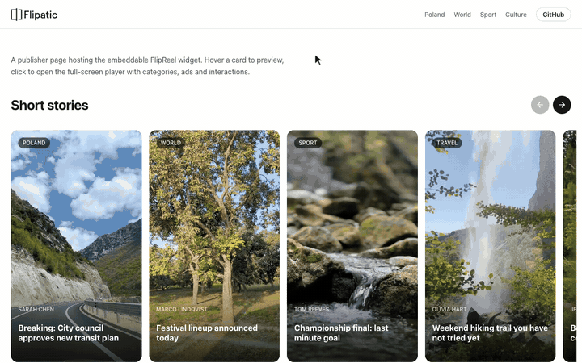

<p align="center">
  <picture>
    <source media="(prefers-color-scheme: dark)" srcset=".github/assets/flip-reel-wordmark-dark.svg" />
    
  </picture>
</p>

<p align="center">
  Bring short-form video to your own website. A free, open-source carousel of vertical videos
  for news sites: one script tag, your feed, your ads.
</p>

<p align="center">
  <a href="https://www.npmjs.com/package/@flipatic/flip-reel"></a>
  <a href="https://bundlephobia.com/package/@flipatic/flip-reel"></a>
  <a href="https://github.com/Flipatic/flip-reel/actions/workflows/ci.yml"></a>
  <a href="LICENSE"></a>
</p>

<p align="center">
  <a href="https://flip-reel-demo.vercel.app/"><b>Live demo</b></a> ·
  <a href="docs/reference">API reference</a> ·
  <a href="docs/architecture.md">Architecture</a> ·
  <a href="https://github.com/Flipatic/flip-reel/discussions">Discussions</a>
</p>

<p align="center"></p>

Your short videos should not live only on social media. FlipReel puts a carousel of vertical
videos on your homepage, section pages or inside articles and opens them in a full-screen,
swipeable player on desktop and mobile.

It is also built for the engineering teams who have to embed third-party code on pages they
care about. The widget renders inside Shadow DOM, makes no network requests except your feed,
the media in it and the ad code you plug in, stores nothing by default, and hands ad breaks to
your own ad stack through a small adapter contract.

FlipReel works with any JSON feed of MP4 videos and images. It is maintained by
[Flipatic](https://flipatic.com), which turns news articles into short videos, but it does not
require Flipatic or any other service.

## For publishers

- **Your videos, from any production process.** Any vertical 9:16 MP4, made with any tool or
  team. If you already produce vertical videos for social media, show the same files to your
  own readers. Videos made in Flipatic work too, but Flipatic is not required.
- **A new ad placement.** Ad breaks between videos, every fourth slide by default. You set
  frequency, duration and skip rules; the ad comes from your own ad stack.
- **Video views that turn into article visits.** Each video can link to its source article,
  and readers can click through while it plays. Works for full stories and for short teasers.
- **Looks like your site.** Fonts, colours, corner radius and spacing follow your brand, and
  the component works with any CMS or frontend framework.

FlipReel is still evolving. Tell us what works and what you'd like us to build next in
[Discussions](https://github.com/Flipatic/flip-reel/discussions) or at
[opensource@flipatic.com](mailto:opensource@flipatic.com).

## For engineering teams

- **Isolation in both directions.** Autonomous custom elements with open Shadow DOM: host-page
  CSS does not leak in, widget CSS does not leak out. Styling goes through documented
  `--flip-reel-*` custom properties. See [Theming](docs/reference/theming.md).
- **Bring your own ads.** Ad breaks are view-gated (every Nth viewed slide), labelled, with a
  countdown, a no-fill timeout (2.5 s by default) and a skip gate. What renders inside the break
  is your code, via the `AdAdapter` contract. A Google Ad Manager
  reference adapter ships as `@flipatic/flip-reel-ad-gpt`. See [Adapters](docs/reference/adapters.md).
- **Built with Core Web Vitals in mind.** One self-contained bundle (Lit is bundled in),
  a page-global media scheduler that caps concurrent video decoders across all widget
  instances, and short muted `preview` renditions so the rail never downloads full videos.
- **No tracking, no storage by default.** The default state store lives in memory. Persistence
  (for example "viewer already watched one full ad") is opt-in via `createLocalStorageStateStore()`
  or your own `StateStore`, under your consent setup.
- **Analytics through DOM events.** Every interaction is a typed `flip-reel:*` `CustomEvent`
  (`view`, `play`, `like`, `share`, `readmore`, `ad:impression`, ...). Forward them to GA4,
  Matomo or your own pipeline. See [Events](docs/reference/events.md).
- **Any framework.** Plain HTML, WordPress or any CMS template, React, Vue, Nuxt, Svelte. The
  repo contains a working demo for each in [`apps/`](apps).

### Bundle size

Measured on the published 0.2.0 tarball of `@flipatic/flip-reel` with `gzip -9`:

| File                                  | Raw    | gzip  |
| ------------------------------------- | ------ | ----- |
| `dist/bundle/flip-reel.js` (ESM)      | 117 KB | 29 KB |
| `dist/bundle/flip-reel.iife.js` (CDN) | 99 KB  | 27 KB |

The architecture sets a hard ceiling of 30 KB gzip for the widget bundle.

## Quick start

### One tag, no build step

```html
<script type="module" src="https://unpkg.com/@flipatic/flip-reel@0.2.1"></script>

<flip-reel feed="https://publisher.example/reels.json" locale="en"></flip-reel>
```

Pin the version in production. Attributes cover the common options; see
[Elements](docs/reference/elements.md) for the full list.

### npm

```bash
npm i @flipatic/flip-reel
```

```ts
import { mount } from '@flipatic/flip-reel'

const reels = mount(document.querySelector('#reels')!, {
  feed: 'https://publisher.example/reels.json',
  locale: 'pl',
  rail: { maxVisible: 10, scrollBy: 4 },
  ads: { every: 4, durationMs: 5000 },
})

reels.addEventListener('flip-reel:view', (event) => {
  console.log('viewed', event.detail.storyId)
})
```

### With Google Ad Manager

```bash
npm i @flipatic/flip-reel-ad-gpt
```

```ts
import { mount } from '@flipatic/flip-reel'
import { createGptAdAdapter } from '@flipatic/flip-reel-ad-gpt'

mount(document.querySelector('#reels')!, {
  feed: 'https://publisher.example/reels.json',
  adapters: {
    ad: createGptAdAdapter({ adUnitPath: '/1234567/flip-reel', sizes: [[300, 250]] }),
  },
})
```

## Feed format

A feed is JSON: `{ "stories": [...], "categories": [...] }` or a bare array of stories. You can
also pass an inline object or an async function instead of a URL.

```json
{
  "stories": [
    {
      "type": "video",
      "id": "s1",
      "title": "Behind the scenes",
      "category": "culture",
      "video": "https://cdn.example/s1.mp4",
      "poster": "https://cdn.example/s1.jpg",
      "preview": "https://cdn.example/s1-preview.mp4",
      "link": "https://publisher.example/articles/1"
    }
  ]
}
```

Malformed stories are dropped, and `link` values that are not `http(s)` or relative are
removed. Full contract: [Feed format](docs/reference/feed.md).

## Theming

```css
flip-reel {
  --flip-reel-radius-card: 12px;
  --flip-reel-progress-fill: #ff4d6d;
  --flip-reel-heading-color: #0a0a0a;
}
```

## Packages

| Package                                         | Description                                                                                  |
| ----------------------------------------------- | -------------------------------------------------------------------------------------------- |
| [`@flipatic/flip-reel`](packages/reels)         | Web components `<flip-reel>`, `<flip-reel-rail>`, `<flip-reel-player>`, tokens, `pl`/`en`    |
| [`@flipatic/flip-reel-core`](packages/core)     | Headless engine: config, feed loading, player/ad state machines, media scheduler, stores     |
| [`@flipatic/flip-reel-ad-gpt`](packages/ad-gpt) | Reference Google Ad Manager ad adapter                                                       |
| [`@flipatic/flip-reel-react`](packages/react)   | React bindings via `@lit/react` (not published to npm yet; the web component works in React) |
| [`apps/`](apps)                                 | Demo pages for plain HTML, React, Vue, Nuxt and Svelte                                       |

## When FlipReel is a good fit

- You publish short vertical videos (MP4) and want them on your own pages, next to your own
  ads, instead of only on social platforms.
- Your team needs to read and audit the embed: TypeScript source, sourcemaps in the published
  bundle, no `eval`, no feed data rendered through `innerHTML`.

Not covered today: adaptive streaming (HLS/DASH), server-side rendering of the widget, and a
no-JS fallback built from server-rendered links. These are on the roadmap below.

## Documentation

- [API reference](docs/reference): options, events, elements, theming, adapters, feed format,
  core API
- [Architecture](docs/architecture.md): design decisions and their trade-offs
- [llms.txt](llms.txt): docs index for AI coding assistants; a Claude Code integration skill
  ships in [`.claude/skills/flip-reel`](.claude/skills/flip-reel)

## Roadmap

Planned in [docs/architecture.md](docs/architecture.md), not implemented in 0.2.1:

- Restart and prefetch policies for the player (open pull request)
- Bundle-size budget enforced in CI
- Cross-browser end-to-end tests (Playwright, including WebKit)
- Version-collision guard when two FlipReel builds load on one page
- Progressive enhancement: adopt server-rendered `<a>` cards as initial data (SEO, no-JS)
- Published SRI hashes per release and a documented CSP setup
- More locales (currently `en`, `pl`)

Ideas and votes: [Discussions](https://github.com/Flipatic/flip-reel/discussions).

## Development

Requirements: Node 20+, pnpm 10.

```bash
pnpm install
pnpm build                                   # all packages
pnpm --filter @flipatic/flip-reel-demo dev   # demo page (after build)
pnpm test                                    # unit tests (Vitest)
pnpm typecheck
pnpm lint
```

See [CONTRIBUTING.md](CONTRIBUTING.md) for the workflow and release process.

## Contributing

Bug reports, adapters and fixes are welcome. Start with an issue labelled
[`good first issue`](https://github.com/Flipatic/flip-reel/labels/good%20first%20issue), read
[CONTRIBUTING.md](CONTRIBUTING.md) and the [Code of Conduct](CODE_OF_CONDUCT.md). Security
issues: see [SECURITY.md](SECURITY.md).

## Credits

FlipReel is a [Flipatic](https://flipatic.com) project. It was designed and built by
[Autentika](https://autentika.com), which remains a maintainer.

## License and trademark

Code is released under the [Apache License 2.0](LICENSE). You can use, modify and distribute it,
including in commercial products. Keep the attribution in [NOTICE.md](NOTICE.md) in derivative
works.

The "FlipReel" name is a trademark and is not licensed under Apache 2.0. Forks must be released
under a different name. See [NOTICE.md](NOTICE.md).
